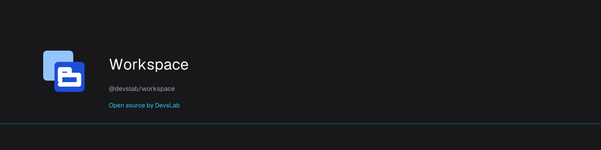

# Workspace

<p align="center">
  <a href="https://devslab.kr/brand/open-source/"></a>
</p>

<!-- publisher:start -->
Open source by [데브스랩(DevsLab)](https://devslab.kr/).
<!-- publisher:end -->

[](https://www.npmjs.com/package/@devslab/workspace)
[](https://github.com/devslab-kr/workspace/actions/workflows/verify.yml)

[](./LICENSE)

[English](README.md) · **한국어** · [문서](docs/README.md) · [OSS 브랜드 가이드](https://devslab.kr/brand/open-source/)

열린 업무 탭, 단축키, 화면 전환 모달을 제공한다. 공통 TypeScript 코어와 Solid·React·Vue·Svelte 어댑터를 구현했다. 앱의 폼·데이터·라우터·권한은 앱이 관리한다.

등록한 화면을 열면 탭이 자동으로 생성되고, 열린 화면 전환 모달도 함께 제공한다. 화면 컴포넌트와 업무 로직은 앱에서 연결한다. `@devslab/workspace`는 0.1.1부터 Apache-2.0 라이선스를 사용하며, 기존 공개 버전 0.1.0은 원래 MIT 라이선스로 유지된다. DDS는 별도의 source-available 디자인 시스템이다.

## 설치

```sh
npm install @devslab/workspace
# 사용할 어댑터의 peer 패키지만 설치한다. Solid 예시:
npm install solid-js @ark-ui/solid@5.39.3
```

## 사용법

```tsx
import { Workspace } from '@devslab/workspace/solid';
import '@devslab/workspace/style.css';
<Workspace screens={[
  { id: 'orders', title: '주문', component: OrdersPage },
  { id: 'customers', title: '고객', component: CustomersPage },
]} defaultScreen="orders" />;
```

처음 연 화면만 마운트한다. 전환하면 hidden/inert로 유지하며 닫으면 해제한다. 다시 열면 새 인스턴스다. 기본 상한은 9개, 슬롯 번호는 재정렬하지 않는다. Alt+1–9로 선택하고 Alt+Q로 전환 모달을 연다. 방향키는 탭 포커스만 옮기고 Enter/Space가 선택하며 Delete가 닫는다. 모바일에서는 버튼으로 모든 명령을 실행한다.

기본 import와 `./core`는 프레임워크를 요구하지 않는다. 어댑터를 사용할 때만 해당 프레임워크와 Ark peer를 설치한다: Solid는 `solid-js`·`@ark-ui/solid`, React는 `react`·`react-dom`·`@ark-ui/react`, Vue는 `vue`·`@ark-ui/vue`, Svelte는 5.29 이상·`@ark-ui/svelte`. 공개 props와 콜백은 Workspace API이며 Ark details 객체를 전달하지 않는다.

기존 메뉴 안에서는 `useWorkspace().open(id)`만 연결한다. 바깥에서 접근해야 하면 `createWorkspace({screens,...})`로 컨트롤러를 만들고 `<Workspace controller={controller} screens={screens} menu={false}>`에 전달한다. 컨트롤러 사용 시 가드·상한·기본 화면을 컴포넌트에 중복 설정하지 않는다. 컨트롤러를 넘기면 컨트롤러의 목록이 레지스트리이고, `screens` prop은 컴포넌트가 없는 컨트롤러 정의에 같은 id의 컴포넌트를 채워 줄 뿐이다. 옵션과 `screens` prop은 한 번만 읽는다. 실행 중 화면 변경은 컨트롤러로 한다([아래](#런타임-화면-등록)). 앱 identity가 바뀌면 다시 마운트한다.

명령은 open/select/close/showSwitcher/hideSwitcher/cancelPending/reset과 아래 레지스트리 메서드다. select는 열린 탭만 선택한다. open·select의 비동기 가드가 거절되거나 실패하면 현재 화면을 유지한다. 단, 확인 중인 화면이 이미 보이고 있으면(활성 화면을 다시 열 때, `showRetainedFirst`, 라우터가 먼저 보여 준 화면) 활성 화면이 없는 상태가 된다. 마지막 유효 요청만 반영한다. 닫기는 다음 화면을 기다리지 않는다. beforeClose가 허용하면 탭이 바로 빠지고 옆 화면이 바로 보이며, 그다음에 옆 화면의 beforeActivate를 확인한다. 거절하면 close는 `denied`로 끝나고 활성 화면이 없는 빈 상태가 된다. 이때 남은 첫 탭은 Tab 키로 들어갈 수 있다. 예외가 나면 같은 빈 상태로 바꾼 뒤 reject한다. 확인이 끝나기 전에 다른 open·select가 반영되거나 `show()`가 다른 화면을 보여 주거나 reset이 실행되거나 보이던 옆 화면이 먼저 닫히거나 회수되면, 그 확인은 적용하지 않고 close는 `stale`로 끝난다. 닫기는 0.2.0과 같이 beforeClose가 없어도 마이크로태스크 한 번을 기다린 뒤 반영한다. 닫은 버튼이 사라지면 포커스는 보이는 탭으로 옮기지만, 사용자가 이미 옮겨 간 화면 안의 포커스는 빼앗지 않는다. reset은 닫기 확인을 건너뛰고 전체 화면과 미완료 요청을 폐기하므로 로그아웃·회사 변경에 사용한다.

CSS는 선택이며 `--ws-*` 변수, classNames, 콘텐츠 슬롯, unstyled로 바꾼다. 전체 레이아웃은 WorkspaceProvider·WorkspaceTabList·WorkspaceTab·WorkspaceCloseButton·WorkspacePanels·WorkspaceSwitcher·WorkspaceSwitcherTrigger·WorkspaceStatus로 조립한다. 닫기 버튼은 role=tablist 바깥에 둔다. asChild는 기존 버튼의 이벤트와 ref를 연결하며 preventDefault가 동작을 취소한다. 비활성 화면 숨김과 포커스 차단은 CSS 없이도 유지된다.

DDS를 사용하면 라이선스가 적용된 DDS 토큰과 `@devslab/workspace/style.css` 다음에 `@devslab/workspace/dds.css`를 불러온다. 이 선택 파일은 DDS 변수만 참조하며 DDS 자산을 포함하지 않는다. 모달이 body에 포털로 렌더되므로 테마 변수는 `:root`에 설정하거나 워크스페이스와 모달 양쪽 클래스에 설정한다. 배경·글자·선·강조·포커스·오버레이·폰트·모달 반경/그림자를 변경할 수 있다.

페이지 전용 hook은 선택이다. useWorkspacePage/useActiveEffect로 활성 화면의 구독과 해제를 연결한다. 타이머·요청·캐시·앱 모달 포털은 앱이 관리한다. 라이브러리는 자동 조회, invalidate, DOM 미리보기 복제, 분석 전송을 하지 않는다. 입력창·IME·반복 키·모달에서는 단축키를 가로채지 않으며 shortcuts로 변경/해제할 수 있다.

기본 화면은 mount 후 열어 SSR은 빈 상태로 시작한다. 서버에서 현재 탭이 필요하면 요청별 컨트롤러를 먼저 열고 SSR에 전달한다(등록 규칙은 아래 런타임 화면 등록 참고). dir를 지정하면 서버에서도 올바른 RTL이 된다. Next/Nuxt/SvelteKit 통합은 검증했다고 주장하지 않는다.

선택 API `createHistoryWorkspace(options, browserHistory(window))`가 URL 진입·뒤로가기·앞으로가기를 연결한다. screenFromUrl/urlForScreen을 제공하고 controller/ready/sync/dispose를 사용한다. `sync()`는 현재 URL을 다시 읽어 그 화면을 연다. 거절된 뒤로가기는 마지막 허용 URL로 replace하며 새 항목을 추가하지 않는다. 앱에서 화면을 고르면 변경된 URL만 push한다. 활성 탭을 닫으면 옆 화면이 보이는 즉시, 가드 결과보다 먼저 그 URL을 push한다. 마지막 허용 URL은 항상 확인이 실제로 허용한 마지막 화면이다. 자기 확인이 도는 동안 보이는 화면(닫은 탭의 옆 화면, `showRetainedFirst`)은 새 확인 아래에서 돌더라도 그 확인이 허용해야 허용 URL이 된다. 옆 화면의 가드가 거절하면 URL은 거절된 화면에 남지만, 이후 거절된 이동은 마지막으로 허용된 화면의 URL로 되돌린다. 거절된 화면의 URL을 다시 불러오면 가드를 다시 확인한다. 가드가 있으면 등록되지 않은 id로의 뒤로가기·앞으로가기도 가드를 실행하고 그다음 레지스트리를 읽는다. dispose는 리스너와 화면을 정리하고 런타임 등록을 버려 시작 목록으로 되돌린다. 다른 라우터의 `show()`와 함께 쓰지 않는다. URL 소유자는 워크스페이스마다 하나다. 동기 History 어댑터이며 TanStack 등의 비동기 loader·라우터 취소는 앱에서 연결한다.

검증 명령과 프레임워크별 사용법은 [영문 가이드](README.md), [SolidJS](docs/solid.md), [React/Vue](docs/react-vue.md), [Svelte](src/svelte/README.md)에 있다. 공개·배포·임시 체크아웃 정리는 검증된 변경을 통합한 뒤 진행한다.

## 런타임 화면 등록

컨트롤러는 실행 중에 바뀌는 레지스트리를 가진다. `screens` 옵션(또는 단독 사용 시 prop)은 선택이며 시작 목록일 뿐이다. 앱 라우터는 경로가 허용되면 화면을 등록하고 권한을 잃으면 제거한다. 화면은 `screens` prop을 바꾸지 말고 컨트롤러(워크스페이스 안에서는 `useWorkspace()`, 또는 넘긴 컨트롤러)로 바꾼다.

```ts
import { createWorkspace, type AdapterScreen } from '@devslab/workspace/solid';

const controller = createWorkspace<AdapterScreen, { draft: string }>({
  home: 'dashboard',
  createTabData: () => ({ draft: '' }),
  beforeActivate: id => navigateAndReport(id), // 이 결과가 나오기 전에 라우트가 화면을 등록한다
});
// 라우터에서 경로가 허용된 뒤:
controller.register({ id: path, title, component: Page }, { show: true });
// 권한이 바뀌면:
controller.retainOnly(allowedIds);
```

- `register(screen, { show?, renew? })`는 정의를 추가하거나 갱신하고 `ok` 또는 `limit`을 돌려준다. 열린 화면을 갱신하면 제목과 페이지가 읽는 정의만 바뀌고 탭·페이지·데이터는 그대로다. 탭은 만들 때의 컴포넌트를 계속 쓴다. `{ renew: true }`는 열린 탭을 같은 슬롯·같은 위치에서 새 인스턴스와 새 데이터로 바꾸며 기존 페이지를 해제한다. 탭 상한을 넘으면 정의는 저장하고 탭만 거절한다.
- `show(id)`는 등록된 화면을 활성으로 만들고 `ok`·`unknown`·`limit`을 돌려준다. **`show()`와 `register(…, { show: true })`는 가드를 실행하지 않는다.** 이미 경로를 허용한 앱 라우터용이다. 확인 중인 화면을 보여 주는 것은 그 확인의 일부이고, 다른 화면을 보여 주면 확인은 `stale`로 끝난다.
- `unregister(id)`와 `retainOnly(ids)`는 닫기가 아니라 회수다. beforeClose 없이, 옆 화면도 보여 주지 않고 정의와 탭을 함께 지운다. 활성 탭이 지워지면 앱이 다른 화면을 보여 줄 때까지 활성 화면이 없다. 이후 `open(id)`는 가드에 다시 묻는다. 지워진 화면의 진행 중 확인·열기·닫기는 `stale`로 끝난다. `retainOnly`는 지운 id를 돌려준다. `reset()`은 모든 탭을 닫고 시작 목록을 그대로 복원한다.
- 등록되지 않은 id의 `open(id)`: beforeActivate가 없으면 `unknown`이다. 가드가 있으면 탭 상한을 확인하고 가드를 실행한 뒤 레지스트리를 읽는다. 그 사이 라우트가 화면을 등록했으면 열고, 아니면 `unknown`이다.
- `home`(id 또는 id를 돌려주는 함수): 하나 남은 탭이 home이면 닫기를 거절(`cancelled`)하고 `canClose(id)`가 false라 기본 닫기 버튼이 비활성화되고 Delete도 동작하지 않는다. 다른 화면의 마지막 탭을 닫으면 가드를 거쳐 home을 연다. home이 등록되지 않았고 beforeActivate 가드도 없으면 마지막 탭은 그대로 닫히고 `close()`는 `unknown`으로 끝난다(빈 작업 공간). 기본 부품은 스냅샷이 바뀔 때 비활성 상태를 다시 읽으므로, 바깥 상태를 읽는 `home` 함수는 다음 변경 때 반영된다.
- `showRetainedFirst: true`: 열린 탭의 `open(id)`는 그 탭을 바로 보여 주고 그다음 확인한다. 거절되면 활성 화면이 없다. 확인 중에 다른 탭을 닫거나, 다른 화면의 `open`이 반영되지 않고 끝나거나, `cancelPending()`(URL 어댑터는 새 URL마다 호출한다)을 불러도 그 확인은 끝나지 않고 그 답이 결과를 정한다. 닫은 탭의 옆 화면 확인과 같다. URL 어댑터는 확인이 허용한 뒤에야 그 화면의 URL을 받아들이므로, 거절된 뒤로/앞으로 이동은 마지막으로 받아들인 URL로 되돌린다.
- `createTabData(screen)`는 탭 인스턴스마다(새 탭 또는 renew) 한 번 실행되며, 그 값이 `Tab.data`와 `useWorkspacePage().data`다. 없으면 `data`는 `undefined`다. 코어 타입의 데이터 매개변수(`Tab<D>`·`Snapshot<S, D>`·`Options<S, D>`) 기본값은 `undefined`이고, `useWorkspacePage<D>()`의 기본값은 `unknown`이므로 `data`의 타입은 `D`로 지정한다.
- `snapshot.pendingId`는 beforeActivate가 실행 중인 id이며 모든 종류의 확인에 해당한다. 보이는 화면의 확인이 아래에서 계속 실행되는 중에 새 확인이 시작되면 새 확인의 id다. `snapshot.activePending`은 활성 화면의 확인이 어느 깊이에서든 실행 중이면 `true`이고 아니면 없다. 기본 탭은 `pendingId`를 `aria-busy`로 표시한다. 아직 탭이 없는 id는 선택 슬롯 `slots.pendingTab(id)`가 기본 탭 줄의 닫기 버튼 뒤, 탭 목록 바깥에 `pending` 부품으로 그린다. 슬롯이 없으면 아무것도 그리지 않는다.
- `getScreen(id)`·`getTab(id)`·`canClose(id)`는 현재 상태를 읽는다.
- 페이지: `useWorkspacePage()`는 `{ id, active, data, screen }`을 돌려준다. `screen`은 현재 정의라 다시 마운트하지 않고 제목이 바뀐다. 기본 패널은 여전히 props 없이 컴포넌트를 렌더한다.
- 어댑터 정의는 `AdapterScreen`이다(`component` 선택). 컨트롤러를 넘기면 그 목록이 우선이고 `screens` prop이 빠진 컴포넌트를 id로 채운다. 어느 쪽에도 컴포넌트가 없는 화면은 빈 패널이 되고, 나중에 추가한 컴포넌트는 `renew`로만 적용된다.
- 기본 메뉴는 `screens` prop이 비어 있지 않으면 그 목록을, 아니면 현재 레지스트리를 보여 준다. `menus` 항목은 아직 등록되지 않은 화면을 가리킬 수 있으며, 그 항목에는 `label`을 준다.
- 리스너와 `onChange`는 모든 반영 안에서 동기로 실행되며 가드 실행 중에도 실행된다(`pendingId` 변경). **스냅샷 변경에 반응해 화면을 등록하거나 보여 주면 안 된다.** 등록은 라우터의 일이다.
- SSR: 렌더 전에 요청별 컨트롤러에 등록(과 show)하고, 요청마다 컨트롤러 하나를 쓰며, 클라이언트에서 같은 등록을 같은 순서로 다시 실행해 슬롯을 맞춘다. Vue에서는 `showRetainedFirst` 같은 불리언 옵션을 바인딩한다(`:show-retained-first="true"`). 값 없는 속성은 `''`로 전달되어 `true`가 아니다. Solid·Svelte·Vue는 탭 부품이 렌더되기 전이라면 렌더 중 등록도 받는다. 이때 Vue는 하이드레이션 전까지 그 탭을 `aria-selected="false"`로 렌더하며 불일치는 생기지 않는다. React는 렌더 전 등록만 지원한다.

## 기여

개발 환경과 검증 절차는 [CONTRIBUTING.md](CONTRIBUTING.md)에 있다. 릴리스 담당자는 [OIDC 배포 안내](docs/releasing.md)를 따른다.

## 관련 프로젝트

- [kokey](https://github.com/devslab-kr/kokey) — 업무 폼의 키보드 자판 변환.
- [numkey](https://github.com/devslab-kr/numkey) — 커서 위치를 유지하는 숫자 입력.
- [DDS](https://github.com/devslab-kr/dds) — 별도 라이선스의 디자인 시스템. Workspace 토큰 연결 파일을 선택적으로 사용할 수 있다.
- [DevsLab 오픈소스](https://github.com/devslab-kr).

## 라이선스

[Apache-2.0](LICENSE) © [DevsLab](https://devslab.kr/).
